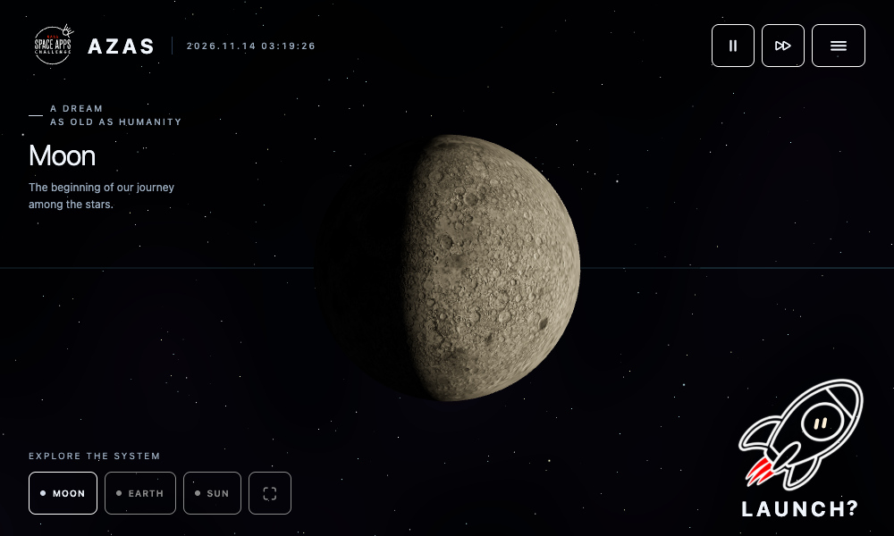
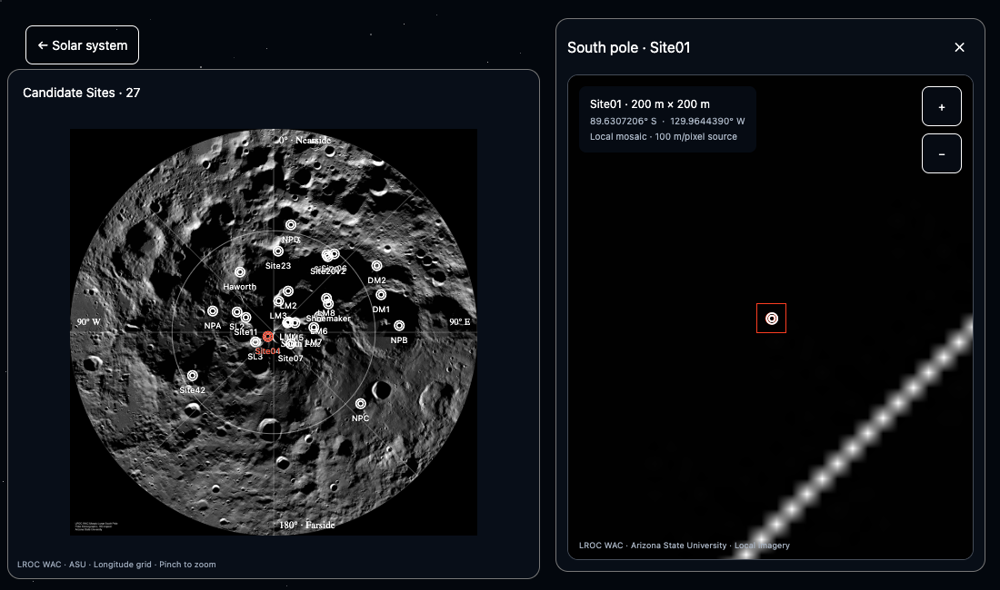
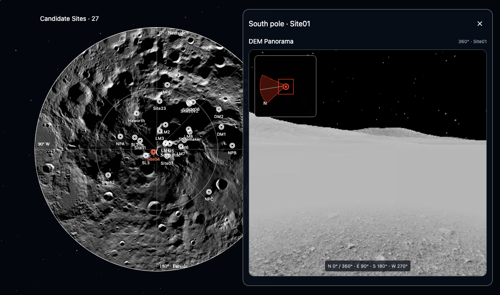

# LAMP - Lunar Access and Mission Planning

**[Open the live demo → https://azas-fe-xi.vercel.app/](https://azas-fe-xi.vercel.app/)**

**NASA Space Apps Seoul 2026 · Team AZAS**

**Frontend development: JIN KIM**

An interactive lunar exploration and mission-planning frontend that connects a visual journey through the Sun–Earth–Moon system with lunar south-pole landing candidates, launch opportunities, preliminary transfer trajectories, and post-landing sky observations.

Built with **React Native, Expo, TypeScript, and Three.js**, AZAS brings a complex mission workflow into one landscape-first experience: explore the Moon, choose a destination, find a mission opportunity, select a launch, and follow the journey to the surface.

> This repository contains the frontend. Mission analysis is provided by a separately operated backend. AZAS is a hackathon demonstration and educational visualization, not an operational flight-planning system.

## Preview



| Lunar south-pole exploration | Candidate panorama and orientation |
| --- | --- |
|  |  |

These are development screenshots from the repository. They illustrate the experience; individual labels and layouts may differ from the latest deployment.

## Project overview

Choosing a lunar destination involves more than a point on a map. A visitor needs to understand where a candidate lies, what the surrounding terrain looks like, when sunlight and Earth visibility are available, and how a launch opportunity relates to the intended arrival.

AZAS presents those questions as a guided visual sequence. The frontend combines an interactive celestial scene, geographically placed candidate markers, bundled terrain visualizations, and backend analysis results. An animated rocket companion supplies guidance throughout the experience.

### At a glance

| Item | Details |
| --- | --- |
| Event | NASA Space Apps Seoul 2026 |
| Team | AZAS |
| Frontend developer | JIN KIM |
| Live frontend | [azas-fe-xi.vercel.app](https://azas-fe-xi.vercel.app/) |
| Repository | [NASA-AZAS/AZAS-FE](https://github.com/NASA-AZAS/AZAS-FE) |
| Application | Expo / React Native with a web export |
| Presentation | Landscape orientation, dark interface, English UI |
| Hosting configuration | Vercel, static export to `dist/` |

## Current implementation

### Interactive Sun–Earth–Moon scene

- Render the Sun, Earth, Moon, stars, and orbit lines with Three.js and React Three Fiber.
- Drag to orbit the camera; use pinch gestures or the mouse wheel to zoom where supported.
- Focus on a celestial body and move between overview and close-up views with animated camera transitions.
- Pause, resume, reset, and change the accelerated simulation speed.
- Display a simulation date synchronized with the illustrative orbital motion.

The overview exaggerates body sizes and lunar separation for readability. Close-up views use a different scale. The introductory orbital simulation is illustrative; it is separate from backend mission calculations.

### Lunar south-pole candidate explorer

- Retrieve landing candidates from the backend and place them at their lunar coordinates.
- Explore a bundled south-pole mosaic and select a candidate from the map or selection interface.
- View site-specific terrain panoramas, a local minimap, and camera azimuth/elevation readouts.
- Show sunlight and Earth-visibility summaries when the backend supplies valid values.
- Use guided dialogue to introduce the lunar south pole and candidate-selection workflow.

Bundled map crops and panoramas cover the project's 27 candidate identifiers. The live candidate list depends on the backend response; a local JSON snapshot does not replace that API request.

### Mission date analysis and launch selection

- Enter a UTC mission deadline; the current default is `2027-01-31`.
- Request analysis for a **48-hour surface activity period**.
- Poll the analysis job and retrieve the selected touchdown opportunity and corresponding launch options.
- Browse launch locations on Earth with site descriptions and credited photographs.
- Keep the selected landing site, touchdown, analysis run, and launch candidate associated throughout the workflow.

The frontend requests the backend's first qualifying touchdown opportunity for the selected constraints. Available dates and launches depend on the analysis result; a successful result is not guaranteed for every selection.

### Preliminary trajectory and journey playback

- Request or reuse a preliminary transfer trajectory for the selected launch candidate.
- Play a launch video and animate the journey using the returned trajectory samples.
- Display a transfer map and distance/speed information derived from the selected trajectory.
- Provide playback speed, pause/resume, and skip controls.
- Handle unavailable solutions and mismatched trajectory metadata with error feedback.

The accepted trajectory segment is Earth-centered ICRF, from translunar injection to lunar arrival. The current API contract targets an Earth-facing lunar offset **2,000 km from the Moon's center**. The transfer visualization therefore does not establish a solved descent to the selected surface location.

### Post-landing sky exploration

- Load the selected surface candidate's post-landing report.
- Explore a terrain panorama and move the timeline within the returned surface activity period.
- Display Sun/Earth positions and terrain visibility from the returned observations.
- Check that the report corresponds to the selected site, touchdown, and surface end time.

## Try the demo

1. Open **[the deployed application](https://azas-fe-xi.vercel.app/)** in a browser with WebGL support. Use a wide desktop window or rotate your phone to landscape.
2. Explore the opening Moon scene. Try the celestial-body controls, camera gestures, and simulation controls.
3. Enter the lunar explorer through the menu or guided rocket interaction.
4. Select a south-pole candidate and inspect its panorama and local context.
5. Enter a UTC deadline and start the mission-opportunity analysis.
6. When results are available, select a launch option on Earth.
7. Choose **Next Stop The Moon** to prepare the preliminary trajectory, then **Start the Journey** to begin playback.
8. After arrival, explore the surface panorama and the available sky-observation timeline.

The mission-analysis steps require an accessible backend. If a combination produces no opportunity or no preliminary transfer, try another candidate, deadline, or launch option. Loading and queue delays depend on the backend service.

## Run locally

### Prerequisites

- **Node.js 22.13.0 or newer within the supported Node 22 release line**, or another version supported by the installed Expo SDK. The installed Expo package declares `^22.13.0 || ^24.3.0 || ^26.0.0 || >=27.0.0`.
- **npm**, included with Node.js.
- **Git** to clone the repository.
- A browser with **WebGL** enabled for the web experience.
- Internet access for dependency installation and backend mission requests.

For native development, use a device/client compatible with **Expo SDK 58**. Opening an iOS simulator requires macOS and Xcode; opening an Android emulator requires Android Studio and a configured virtual device. Native device behavior should be validated separately from the deployed web experience.

### 1. Clone and install

```sh
git clone https://github.com/NASA-AZAS/AZAS-FE.git
cd AZAS-FE
npm ci
```

`npm ci` installs the dependency tree recorded in `package-lock.json`.

### 2. Configure the API

```sh
cp .env.example .env.local
```

The example contains:

```dotenv
EXPO_PUBLIC_API_BASE_URL=https://api.example.com/api/v1
```

| Variable | Purpose | Expected value |
| --- | --- | --- |
| `EXPO_PUBLIC_API_BASE_URL` | Base URL used by the frontend mission API client | A device-reachable HTTP(S) API URL including `/api/v1` |

The URL above is a placeholder. Obtain the backend URL from the team and configure it locally or in the deployment environment. Use the API base URL, not a Swagger/documentation page URL.

Variables beginning with `EXPO_PUBLIC_` are included in the client bundle and are visible to users. Do not place secrets, private tokens, or database credentials in them. Local environment files are ignored by Git.

For a physical device, `localhost` refers to that device. Use a reachable LAN address or a publicly accessible backend. For browser access, the backend must allow the frontend origin through CORS, including `http://localhost:8081` when that is the local Expo origin and `https://azas-fe-xi.vercel.app` for the deployed demo. An HTTPS frontend needs an HTTPS API to avoid mixed-content blocking.

### 3. Start the web app

```sh
npm run web
```

Open the URL printed by Expo, normally **http://localhost:8081**. If that port is occupied, use the port reported by the CLI.

### Other development commands

| Command | Action |
| --- | --- |
| `npm start` | Start the Expo development server and platform selection interface |
| `npm run web` | Start development for the browser |
| `npm run ios` | Start Expo and open the iOS target when available |
| `npm run android` | Start Expo and open the Android target when available |
| `npm run typecheck` | Run TypeScript without emitting files |
| `npm run build` | Export the web application into `dist/` |

Restart the development server after changing environment configuration. If Expo retains stale configuration, restart with `npx expo start --clear`.

### Data and additional setup

No frontend database, migration, seed command, NASA API key, or local TIFF-processing step is required for the checked-in demo assets.

- Planet textures, lunar mosaic derivatives, candidate panoramas, launch-site photographs, and the launch video are loaded from repository assets.
- Live landing-site records, date opportunities, launch options, trajectories, and post-landing reports come from the backend.
- Bundled assets do not make the complete mission workflow available offline.
- When using a different backend dataset, keep candidate site codes compatible with the bundled site-specific assets or provide matching assets.

## Backend integration

The API client lives in [`src/screens/solar-system/mission-api.ts`](src/screens/solar-system/mission-api.ts). It expects successful responses in the form `{ "success": true, "data": ... }`.

| Stage | Endpoint relative to the API base URL |
| --- | --- |
| Landing-site list | `GET /landing-sites` |
| Landing-site details and visibility summaries | `GET /landing-sites/{siteId}` |
| Start opportunity analysis | `POST /landing-sites/{siteId}/date-opportunities` |
| Poll analysis status | `GET /analyses/{runId}` |
| Read touchdown opportunities | `GET /analyses/{runId}/date-opportunities` |
| Read launch options | `GET /analyses/{runId}/launch-options` |
| Read daily visibility results | `GET /analyses/{runId}/daily-results?date=YYYY-MM-DD` |
| Read previous trajectories | `GET /analyses/{runId}/trajectories` |
| Request a trajectory | `POST /analyses/{runId}/launch-options/{candidateId}/trajectory` |
| Poll/read a trajectory | `GET /analyses/{runId}/trajectories/{trajectoryId}` |
| Read post-landing observations | `GET /analyses/{runId}/surface-candidates/{candidateId}/post-landing` |

The frontend handles pending/running analysis states, failed requests, HTTP 429 queue saturation, absent opportunities, and unsupported or inconsistent trajectory metadata. The backend implementation, numerical models, deployment, and data preparation are outside this repository's scope.

## Build and deploy

```sh
npm ci
npm run typecheck
npm run build
```

The web export is written to **`dist/`**. To preview that export locally:

```sh
python3 -m http.server 8080 --directory dist
```

Open **http://localhost:8080**. This optional preview command requires Python 3; Python is not required to build the application.

[`vercel.json`](vercel.json) configures the deployment:

| Setting | Value |
| --- | --- |
| Build command | `npm run build` |
| Output directory | `dist` |
| Development command | `npm run web` |
| Framework preset | No automatic framework preset (`framework: null`) |
| Routing | Requests rewritten to the application root |

When importing this repository into Vercel:

1. Use the repository root as the project root and retain the checked-in Vercel configuration.
2. Select a Node.js version compatible with the installed Expo SDK.
3. Add `EXPO_PUBLIC_API_BASE_URL` to the appropriate Vercel environment, including Production.
4. Ensure the backend allows the deployment origin through CORS.
5. Deploy and open the generated URL in landscape orientation.

The public API URL is bundled during export. Changing it in Vercel requires a new build/deployment; it does not update an already exported bundle.

## Technology and open-source acknowledgments

AZAS uses the following open-source projects. Version declarations below come from this repository's `package.json`; exact resolved versions are recorded in `package-lock.json`.

| Project | Declared version | Role | Package license |
| --- | --- | --- | --- |
| [Expo](https://github.com/expo/expo) | `~58.0.25` | App tooling, native integration, web export | MIT |
| [React](https://github.com/facebook/react) / React DOM | `19.3.0` | Component rendering | MIT |
| [React Native](https://github.com/facebook/react-native) | `0.88.1` | Cross-platform UI | MIT |
| [React Native Web](https://github.com/necolas/react-native-web) | `^0.21.4` | Browser rendering of React Native components | MIT |
| [Three.js](https://github.com/mrdoob/three.js) | `^0.187.0` | Celestial scene, materials, lighting, cameras | MIT |
| [React Three Fiber](https://github.com/pmndrs/react-three-fiber) | `^9.8.2` | React integration for Three.js | MIT |
| [Expo Router](https://github.com/expo/expo/tree/main/packages/expo-router) | `~58.0.31` | Application entry and routing | MIT |
| [React Native Reanimated](https://github.com/software-mansion/react-native-reanimated) | `4.7.1` | Animated UI and shared values | MIT |
| [React Native Gesture Handler](https://github.com/software-mansion/react-native-gesture-handler) | `~3.3.0` | Gesture infrastructure | MIT |
| [React Native Worklets](https://github.com/software-mansion/react-native-worklets) | `0.13.0` | Worklet runtime | MIT |
| [React Native SVG](https://github.com/software-mansion/react-native-svg) | `15.16.0` | Vector overlays and indicators | MIT |
| [React Native Safe Area Context](https://github.com/AppAndFlow/react-native-safe-area-context) | `~5.11.1` | Safe-area layout | MIT |
| [React Native Screens](https://github.com/software-mansion/react-native-screens) | `~4.30.1` | Native screen infrastructure | MIT |
| [Open Bot Avatar](https://www.npmjs.com/package/open-bot-avatar) | `^0.2.1` | Rocket companion eye renderer | MIT |
| [Expo Vector Icons](https://github.com/expo/vector-icons) | `^15.0.2` | Interface icons | MIT package; icon sets have their own licenses |
| [TypeScript](https://github.com/microsoft/TypeScript) | `~6.0.3` | Static typing | Apache-2.0 |

Additional Expo modules provide assets, blur effects, filesystem access, GL rendering, orientation handling, splash screens, status bars, and video playback: `expo-asset`, `expo-blur`, `expo-file-system`, `expo-gl`, `expo-screen-orientation`, `expo-splash-screen`, `expo-status-bar`, and `expo-video`. See `package.json` for their version declarations and upstream packages for full notices.

Open Bot Avatar's retained MIT notice is included in [`docs/licenses/open-bot-avatar-MIT.txt`](docs/licenses/open-bot-avatar-MIT.txt). Package licenses do not automatically apply to bundled imagery, fonts, icon sets, branding, or videos.

## Scientific references, data, and media credits

### Planet textures and astronomical references

- Earth surface, normal, cloud, and Moon textures were copied from the [Three.js example planet textures](https://github.com/mrdoob/three.js/tree/dev/examples/textures/planets). Exact source links are recorded in [`assets/textures/README.md`](assets/textures/README.md).
- The Sun surface, atmosphere, star field, and orbit lines are generated in the scene.
- Mean body sizes, orbital distances, and periods are referenced in the scene code to the [NASA planetary fact sheets](https://nssdc.gsfc.nasa.gov/planetary/factsheet/).
- Educational Moon content draws on [NASA Moon Facts](https://science.nasa.gov/moon/facts/), [Moon Phases](https://science.nasa.gov/moon/moon-phases/), and [Moon Exploration](https://science.nasa.gov/moon/exploration/).

### Lunar terrain and candidate assets

- The active local atlas derives from a supplied `SP_Mosaic.tif`, whose printed legend identifies **Arizona State University**, polar stereographic projection, and **100 m/pixel**.
- The source TIFF is not needed at runtime. Bundled derivatives and calibration metadata are stored in [`assets/lunar-local/`](assets/lunar-local/).
- Candidate snapshots are bundled in `assets/lunar-candidates.json`; current mission-site records are loaded through the API.
- The **27 supplied terrain panoramas** are visualizations, not live surface photographs. Their orientation convention and metadata limitations are documented in [`assets/lunar-panorama/README.md`](assets/lunar-panorama/README.md).
- Earlier development used NASA Lunar Reconnaissance Orbiter imagery through NASA Trek, credited to **NASA / GSFC / ASU**. The current local atlas uses bundled derivatives rather than live WMTS tile requests. Historical experiments are documented in `docs/lunar-explorer.md`.

Source files supplied to the project do not establish a blanket redistribution license for derived media. Preserve existing attribution and confirm source-specific permissions before republishing assets independently.

### Launch-site photography

Launch-site photographs have individual credits and licenses, including public-domain material and Creative Commons licenses. The authoritative per-image records are:

- [`assets/launch-site-photos/credits.json`](assets/launch-site-photos/credits.json): creator, license, source page, and license URL.
- [`assets/launch-site-photos/sources.csv`](assets/launch-site-photos/sources.csv): source inventory.

Retain author attribution, source links, and applicable share-alike requirements when reusing these photographs. Do not treat all photographs as NASA-owned or public domain.

### Project artwork, video, and branding

The rocket artwork, launch video, and event/team graphics are included as project media. Their presence in the repository does not grant a general third-party reuse license. NASA/event names and graphics identify the project context; they do not imply NASA endorsement or certification.

## Known limitations and unimplemented scope

| Area | Current limitation |
| --- | --- |
| Scientific suitability | A visual hackathon prototype; no operational flight certification or guaranteed landing-site safety |
| Introductory simulation | Circular, accelerated orbits and artistic starting phases; not a date-accurate ephemeris |
| Visual scale | Overview sizes and separations are exaggerated; apparent scale varies by view |
| Local map registration | Source TIFF has no GeoTIFF CRS/geotransform tags; alignment is visually calibrated from its printed graticule and resolution |
| Terrain detail | Zoom enlarges the bundled imagery; it does not create detail beyond the source's 100 m/pixel spacing |
| Candidate footprints | Displayed squares are previews based on side length; original surveyed corner/orientation geometry is unavailable |
| Panoramas | Supplied terrain renders; observer-height and generation metadata were not supplied with the images |
| Visibility interpretation | Sun/Earth visibility summaries do not establish a complete electrical power budget or radio link budget |
| Transfer coverage | Preliminary TLI-to-lunar-arrival segment; no solved surface descent, landing control, or complete vehicle dynamics |
| Backend availability | Mission opportunities, trajectories, and post-landing observations require the external API; service uptime and queue time are outside frontend control |
| Offline use | Bundled visual assets are available locally, but the full mission workflow is not an offline application |
| Platform verification | Web is the deployed demo; native iOS/Android interaction and performance require separate device validation |
| Orientation | Best viewed in landscape; browsers and resizable OS windows may ignore orientation-lock requests |
| Device performance | WebGL availability, GPU capability, asset loading, and browser memory affect the 3D experience |

No local replacement for the backend analysis engine or source-DEM generation pipeline is implemented in this frontend.

## Troubleshooting

| Symptom | What to check |
| --- | --- |
| Installation rejects the Node version | Check `node --version` against the Expo engine requirement above |
| Rotate-device prompt | Rotate the device or widen the browser window |
| Blank or unavailable 3D view | Enable WebGL/hardware acceleration and try a compatible browser |
| Landing sites or mission results do not load | Check API reachability, the full `/api/v1` base URL, browser network errors, and backend CORS |
| Works on desktop but not a physical phone | Replace a localhost API URL with a device-reachable address |
| Environment changes do not appear | Restart Expo; for Vercel, rebuild and redeploy |
| Analysis queue is full | The backend returned HTTP 429; retry after the queue clears |
| No opportunity or preliminary trajectory | Try another selection; the backend may return no feasible result for the requested constraints |
| Map appears blurry at high zoom | The source mosaic is 100 m/pixel; enlarged pixels are an expected data limitation |
| API works locally but fails on deployment | Check production environment variables, HTTPS compatibility, and the exact deployed origin in backend CORS |

## Repository guide

```text
src/
  app/                         Expo Router entry and root layout
  components/                  Shared application frame and platform variants
  screens/solar-system/        Scene, explorers, mission API, playback, surface views
  theme.ts                     Shared visual tokens
assets/
  textures/                    Bundled planet and lunar textures
  lunar-local/                 Local mosaic derivatives and calibration metadata
  lunar-panorama/              Candidate-specific terrain panoramas
  launch-site-photos/          Launch photography and individual attribution records
docs/
  evidence/                    Development screenshots
  licenses/                    Retained third-party license notices
  *.md                         Implementation notes and development history
tests/                         Existing focused checks
scripts/hackathon/             Development measurement utilities
.env.example                   Public API configuration example
app.json                       Expo application and platform configuration
vercel.json                    Web deployment configuration
```

Some implementation notes describe earlier prototypes and are historical. Use the current source and API client as the authority for current behavior.

## Contributing and credits

**Team AZAS — NASA Space Apps Seoul 2026**

**Frontend developer: JIN KIM**

For collaboration, follow the organization [contribution guide](https://github.com/NASA-AZAS/.github/blob/main/CONTRIBUTING.md) and [shared pull request template](https://github.com/NASA-AZAS/.github/blob/main/pull_request_template.md).

Use descriptive branches such as `feat/lunar-explorer` or `fix/trajectory-playback`. Include the purpose of the change, API/environment/dependency implications, and the checks actually performed. The standard frontend type check is:

```sh
npm run typecheck
```

### License status

This repository does not currently include a top-level project `LICENSE` file. Do not infer a blanket open-source license for the AZAS application from its dependencies. Third-party software and media retain their respective licenses and attribution requirements.
